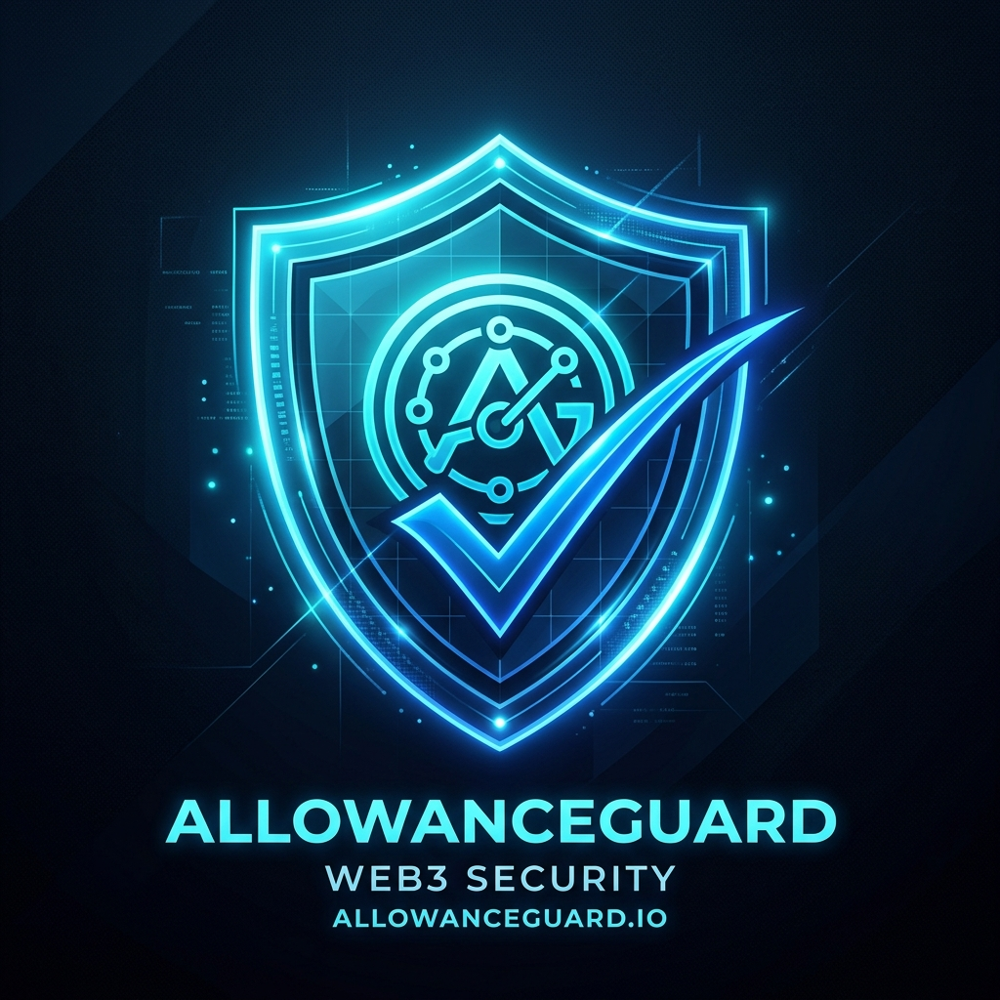

<p align="center">
  
</p>

<h1 align="center">AllowanceGuard</h1>
<p align="center">
  <strong>On-Chain Token Approval Auditing & Risk Mitigation Protocol on Bohr Testnet</strong>
</p>

<p align="center">
  <a href="./WHITEPAPER.md"><strong>Read the Whitepaper »</strong></a>
</p>

---

## ⚡ Overview

**AllowanceGuard** is a Web3 security protocol and decentralized application built for the **Bohr Testnet**. It enables users to:
- Inspect which smart contracts have permission to spend their ERC-20 tokens.
- Identify dangerous **Unlimited Allowances** ($\ge 2^{255}$).
- Record audit verifications on-chain in `AllowanceGuard.sol` for an immutable security log.
- Revoke approvals in one click via a direct `approve(spender, 0)` transaction.

---

## 📍 Deployed Contracts (Bohr Testnet - Chain ID: 968)

| Contract | Address | Explorer Link |
| :--- | :--- | :--- |
| **AllowanceGuard** | `0xa2dE1360664eCfA02eb0Dd4B35281bd64A871f03` | [View on BohrScan](https://scan.bohr.life/address/0xa2dE1360664eCfA02eb0Dd4B35281bd64A871f03) |
| **MockERC20 (BGUSD)** | `0xeAF13A23013d0D541f2De76625F562Ca858Fe7D4` | [View on BohrScan](https://scan.bohr.life/address/0xeAF13A23013d0D541f2De76625F562Ca858Fe7D4) |

---

## 🏗️ Architecture

```
       [User Wallet]
             │
             ├── (1) recordCheck(token, spender) ──> [AllowanceGuard Contract]
             │                                               │
             │                                               ├─> Reads IERC20.allowance
             │                                               ├─> Stores CheckRecord
             │                                               └─> Emits AllowanceChecked
             │
             └── (2) approve(spender, 0) ──────────> [ERC-20 Token Contract]
                                                             │
                                                             └─> Resets Allowance to 0
```

1. **Smart Contracts (`contracts/`)**:
   - `AllowanceGuard.sol`: Core contract managing state-changing audit checks and batch queries.
   - `MockERC20.sol`: Testnet ERC-20 token for live approval demonstrations.
   - Hardhat test suite with 100% test pass rate.

2. **Frontend (`frontend/`)**:
   - Built on Next.js 16 with Turbopack and React 19.
   - Web3 connectivity via `@reown/appkit`, `@reown/appkit-adapter-wagmi`, and `viem`.
   - Gas-enforced allowance checking with live status feedback.
   - 1-click revocation flow directly to ERC-20 token contracts.

---

## 🚀 Quick Start

### 1. Environment Setup
Configure your keys in `.env.local` (kept private, git-ignored):
```env
PRIVATE_KEY=your_private_key_here
PROJECT_ID=your_reown_project_id_here
RPC_URL=https://rpc.bohr.life
CHAIN_ID=968
EXPLORER_URL=https://scan.bohr.life
CONTRACT_ADDRESS=0xa2dE1360664eCfA02eb0Dd4B35281bd64A871f03
```

### 2. Run Smart Contract Tests
```bash
cd contracts
npx hardhat test
```

### 3. Run the Frontend
```bash
cd frontend
npm run dev
```
Open [http://localhost:3000](http://localhost:3000) in your browser.

---

## 📄 Documentation

- [AllowanceGuard Whitepaper](./WHITEPAPER.md)

## 🛡️ License

MIT License.
