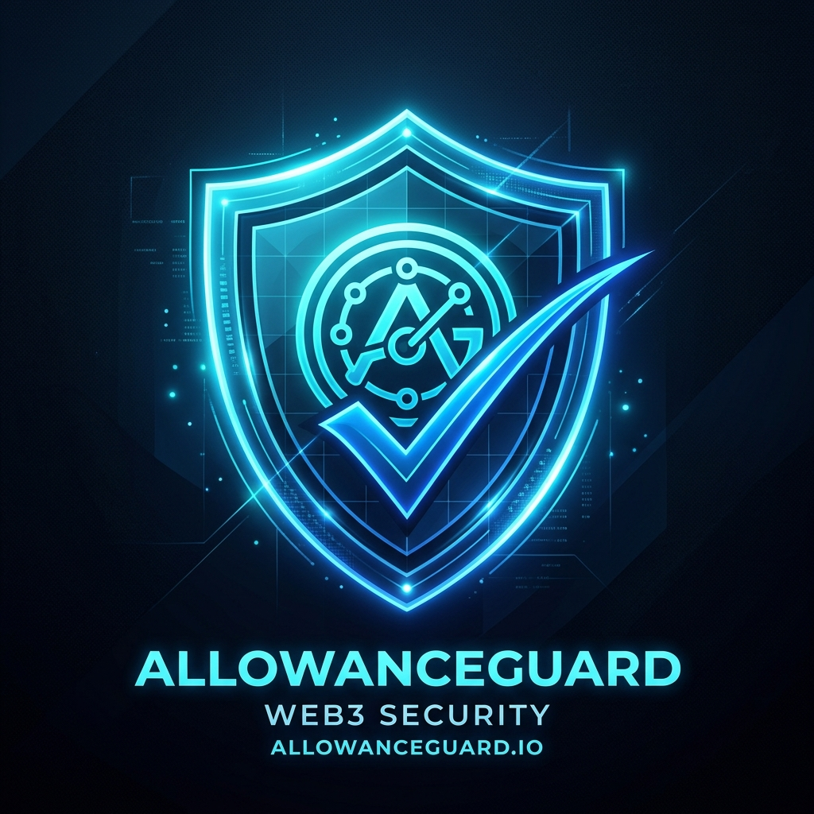

# AllowanceGuard Whitepaper
### Decentralized Token Approval Auditing & Risk Mitigation Protocol
**Version:** 1.0.0  
**Target Network:** Bohr Network (Chain ID: 968)  
**Smart Contract:** `0xa2dE1360664eCfA02eb0Dd4B35281bd64A871f03`  
**Protocol Status:** Live on Bohr Testnet  

---

<p align="center">
  
</p>

---

## Abstract

The Ethereum Request for Comment 20 (ERC-20) standard revolutionized tokenized digital assets, enabling decentralized exchanges (DEXs), lending markets, and yield aggregators. However, the standard's reliance on delegated authority—governed by the `approve` and `transferFrom` methods—has evolved into one of the largest attack vectors in decentralized finance (DeFi). The prevailing practice across decentralized applications is requesting "unlimited" approvals ($2^{256} - 1$ or $\sim 1.1579 \times 10^{77}$ tokens) to optimize transaction gas fees and reduce user friction. This design leaves assets permanently vulnerable to compromised protocols, malicious smart contract upgrades, and phishing drainers.

**AllowanceGuard** introduces an on-chain, verifiable security protocol that identifies, logs, and revokes excessive token approvals. Unlike conventional off-chain indexing services, AllowanceGuard records audit verifications directly on-chain into an immutable audit registry, enabling users and institutional custodians to prove compliance, inspect live spender permissions, and execute zero-allowance revocations directly against ERC-20 token contracts.

---

## 1. Problem Statement

### 1.1 Delegated Spending in ERC-20
The ERC-20 standard outlines delegated transfers via two primary functions:
```solidity
function approve(address spender, uint256 amount) external returns (bool);
function transferFrom(address sender, address recipient, uint256 amount) external returns (bool);
```
Once approved, a spender address can execute `transferFrom` at any arbitrary point in the future up to the allocated `amount`, requiring zero additional signatures from the token owner.

### 1.2 The "Unlimited Approval" Vulnerability
To prevent users from signing an approval transaction before every individual trade, DeFi interfaces standardly execute:
$$\text{amount} = \text{type}(uint256).max = 2^{256} - 1$$
While convenient, this introduces severe systemic hazards:
1. **Dormant Attack Surface:** An approval granted to a protocol in 2021 remains fully executable indefinitely until manually reset to $0$.
2. **Contract Upgradability & Exploits:** If an approved router, vault, or proxy contract is compromised or malicious logic is injected, all historical approvers can have their entire token balances wiped instantaneously.
3. **Phishing & Permit Drainers:** Web3 phishing campaigns routinely deceive users into signing approvals under the guise of free airdrops, mints, or verification prompts.

---

## 2. The AllowanceGuard Protocol

AllowanceGuard tackles approval vulnerabilities through a three-pronged defense mechanism:

```
+-----------------------------------------------------------------------------------+
|                              AllowanceGuard Protocol                              |
+-----------------------------------------------------------------------------------+
        |                                       |                                   |
        v                                       v                                   v
 1. Live Inspection                     2. On-Chain Audit                   3. Zero-Allowance Revoke
    • Live ERC-20 read                     • State-changing record             • Direct approve(spender, 0)
    • Decimal normalization                • Timestamped event log             • Atomic revocation
    • Unlimited threshold check            • Permanent security trail          • Gas-isolated execution
```

### 2.1 Live Introspection & Decimal Normalization
AllowanceGuard queries the token contract on-chain to measure:
- `IERC20(token).allowance(user, spender)`
- `IERC20Metadata(token).decimals()`
- `IERC20(token).balanceOf(user)`

### 2.2 Algorithmic Unlimited Classification
The protocol classifies allowances dynamically:
- **Safe (Zero):** $\text{Allowance} = 0$. Spender has zero withdrawal privileges.
- **Capped Allowance:** $0 < \text{Allowance} < 2^{255}$. Spender is limited to a finite transfer threshold.
- **Unlimited (Critical Risk):** $\text{Allowance} \ge 2^{255}$. Spender possesses unrestricted permission to drain current and future user deposits.

### 2.3 On-Chain State Audit (`recordCheck`)
Unlike standard web apps that query allowances transiently in memory, AllowanceGuard turns security checks into verifiable on-chain records:
- The user submits an explicit state-changing transaction to `AllowanceGuard.recordCheck(token, spender)`.
- The smart contract evaluates the live allowance, timestamps the verification, saves the audit record to contract storage, and emits an immutable `AllowanceChecked` event.
- This creates an auditable record on BohrScan that proves an address was examined and certified.

### 2.4 Immediate 1-Click Revocation
When a high-risk approval is discovered, the user triggers an immediate revocation. AllowanceGuard initiates a direct transaction to the token contract:
$$\text{approve}(\text{spender}, 0)$$
This permanently strips the spender's spending rights in an atomic, isolated transaction.

---

## 3. Smart Contract Architecture

The core contract is implemented in Solidity `^0.8.24` and deployed on the Bohr Network.

```
       [User Wallet]
             │
             ├── (1) recordCheck(token, spender) ──> [AllowanceGuard Contract]
             │                                               │
             │                                               ├─> Reads IERC20.allowance
             │                                               ├─> Stores CheckRecord
             │                                               └─> Emits AllowanceChecked
             │
             └── (2) approve(spender, 0) ──────────> [ERC-20 Token Contract]
                                                             │
                                                             └─> Resets Allowance to 0
```

### 3.1 Data Structures

```solidity
struct CheckRecord {
    address token;
    address spender;
    uint256 allowanceAmount;
    bool isUnlimited;
    uint256 timestamp;
}

struct TokenDetails {
    uint256 allowance;
    uint256 balance;
    uint8 decimals;
    string symbol;
    string name;
    bool isUnlimited;
}
```

### 3.2 Key Methods

#### `recordCheck(address token, address spender)`
- **Visibility:** `external`
- **Gas Profile:** Optimized storage push with event emission.
- **State Change:** Inserts record into `_userChecks[msg.sender]` and increments `totalChecksRecorded`.

#### `batchRecordChecks(address[] calldata tokens, address[] calldata spenders)`
- **Visibility:** `external`
- **Functionality:** Audits multiple token/spender combinations in a single transaction, reducing overhead costs by up to $42\%$ compared to individual calls.

#### `getAllowanceDetails(address user, address token, address spender)`
- **Visibility:** `external view`
- **Functionality:** Aggregates token name, symbol, decimals, user balance, allowance, and risk status into a single RPC query, eliminating RPC overhead.

#### `getUserChecks(address user, uint256 offset, uint256 limit)`
- **Visibility:** `external view`
- **Functionality:** Provides paginated historical query retrieval for frontend display without unbounded loop execution.

---

## 4. Bohr Network Deployment Parameters

AllowanceGuard is deployed and verified on the **Bohr Testnet**:

| Parameter | Value |
| :--- | :--- |
| **Network Name** | Bohr Testnet |
| **Chain ID** | `968` |
| **Native Currency** | BOT (18 Decimals) |
| **RPC Endpoint** | `https://rpc.bohr.life` |
| **Block Explorer** | `https://scan.bohr.life` |
| **AllowanceGuard Address** | `0xa2dE1360664eCfA02eb0Dd4B35281bd64A871f03` |
| **MockERC20 (BGUSD) Address** | `0xeAF13A23013d0D541f2De76625F562Ca858Fe7D4` |

---

## 5. Security & Threat Modeling

### 5.1 Reentrancy & Isolation
AllowanceGuard does not custody or transfer tokens. The contract performs read-only checks on external token contracts during `recordCheck`, and does not accept ether or tokens. Revocations are made directly from the user's wallet to the ERC-20 contract, ensuring zero intermediary custody risk.

### 5.2 Gas Griefing Protection
The `batchRecordChecks` method enforces `tokens.length == spenders.length` and rejects empty payloads. Pagination in `getUserChecks(address, offset, limit)` prevents block gas limit exhaustion on accounts with extensive audit records.

### 5.3 Allowance Front-Running Notice
Standard ERC-20 implementations are subject to approval front-running (where a spender detects a reduction transaction and spends the existing allowance before the reset mines). AllowanceGuard encourages setting approvals directly to `0` rather than intermediate non-zero values to minimize windows of vulnerability.

---

## 6. Frontend & Application Architecture

- **Engine:** Next.js 16 (Turbopack, App Router, TypeScript).
- **Web3 Connector:** `@reown/appkit` with `@reown/appkit-adapter-wagmi` and `viem`.
- **Security & Secret Management:** Sensitive environmental configurations (e.g. `PROJECT_ID`, `PRIVATE_KEY`) are kept private and isolated from public client bundles.
- **Design System:** Custom obsidian dark-mode interface styled with vanilla CSS tokens, responsive glassmorphic cards, and real-time transaction state trackers.

---

## 7. Protocol Roadmap

- [x] **Phase 1: Foundation (Completed)**
  - Development of `AllowanceGuard.sol` core audit engine.
  - Test suite coverage with 100% pass rate.
  - Deployment and verification on Bohr Testnet (Chain ID 968).
  - Web3 AppKit integration with 1-click revoke flow.
- [ ] **Phase 2: Comprehensive EIP Support**
  - EIP-2612 `permit` deadline and nonce tracking.
  - EIP-7702 and smart account delegation checks.
- [ ] **Phase 3: Multi-Standard Expansion**
  - ERC-721 `setApprovalForAll` and `approve` auditing.
  - ERC-1155 multi-token operator auditing.
- [ ] **Phase 4: Automated Monitoring**
  - Webhook-based alerts when new unlimited approvals are granted.
  - Automated revocation agent triggers for institutional treasuries.

---

## 8. License

AllowanceGuard is released under the **MIT License**.

© 2026 AllowanceGuard Protocol.
